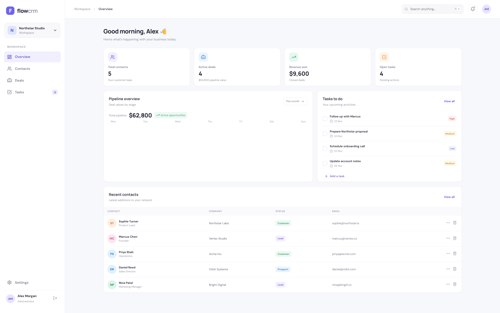
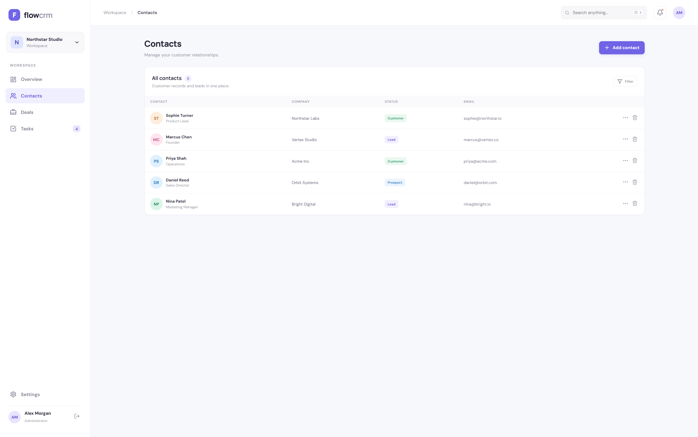
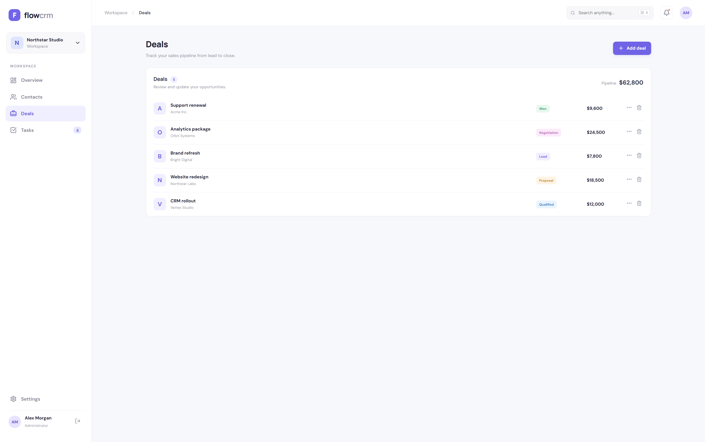
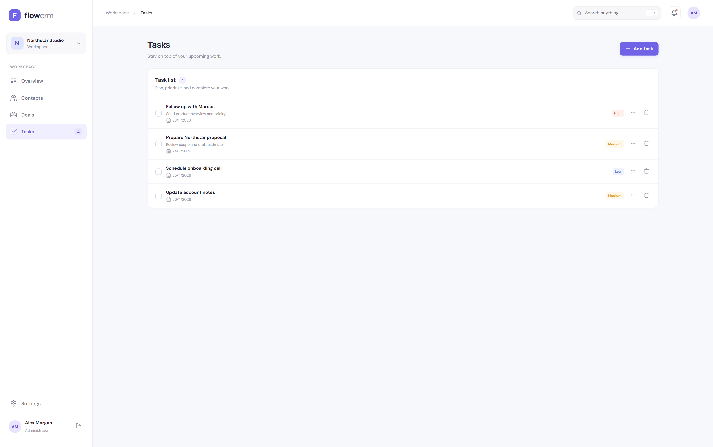

# FlowCRM – Customer Relationship Management

A modern full-stack Customer Relationship Management (CRM) application built using the MERN stack. FlowCRM helps businesses manage customer contacts, track sales opportunities, organize tasks, and monitor business performance through an interactive dashboard.

## 🛠️ Tech Stack


---

## 📸 Screenshots

### Dashboard

<!-- Add your dashboard screenshot here -->



### Contacts Management

<!-- Add your contacts screenshot here -->



### Sales Pipeline

<!-- Add your deals screenshot here -->



### Task Management

<!-- Add your tasks screenshot here -->



---

## ✨ Features

- **Interactive Dashboard** – Overview of customers, deals, revenue, and tasks.
- **Contact Management** – Create, view, edit, search, and delete customer contacts.
- **Sales Pipeline** – Track deals through different sales stages.
- **Deal Tracking** – Monitor deal values, status, and closing dates.
- **Task Management** – Organize tasks with priorities, deadlines, and completion status.
- **Authentication & Authorization** – Secure login using JWT authentication.
- **Data Visualization** – Charts and sales analytics for business insights.
- **Search Functionality** – Quickly find contacts and deals.
- **Responsive Design** – Works across desktop, tablet, and mobile devices.
- **Demo Data** – Seeded data for exploring the application.

---

## 📊 Dashboard Overview

The dashboard provides a quick overview of CRM performance, including:

- Total contacts
- Active deals
- Revenue overview
- Open tasks
- Sales pipeline analytics
- Deal stage distribution

---

## 📁 Project Structure

```text
mern-crm/
│
├── client/                  # React frontend
│   ├── src/
│   │   ├── components/      # Reusable UI components
│   │   ├── pages/           # Application pages
│   │   ├── assets/          # Images and assets
│   │   └── ...
│   │
│   └── package.json
│
├── server/                  # Node.js backend
│   ├── models/              # MongoDB models
│   ├── routes/              # API routes
│   ├── middleware/           # Authentication middleware
│   ├── seed/                # Demo data
│   ├── ...
│   └── package.json
│
└── README.md
```

---

## 🚀 Getting Started

### Prerequisites

Make sure you have the following installed:

- [Node.js](https://nodejs.org/)
- [MongoDB](https://www.mongodb.com/) or MongoDB Atlas
- npm

### 1. Clone the Repository

```bash
git clone https://github.com/ajinkya029/mern-crm.git
cd mern-crm
```

### 2. Setup Backend

```bash
cd server
npm install
```

Create a `.env` file in the server directory:

```env
PORT=5000
MONGO_URI=mongodb://127.0.0.1:27017/flowcrm
JWT_SECRET=your_secret_key
```

### 3. Seed Demo Data

```bash
npm run seed
```

### 4. Run Backend Server

```bash
npm run dev
```

The backend server will run at:

```text
http://localhost:5000
```

### 5. Setup Frontend

Open another terminal:

```bash
cd client
npm install
npm run dev
```

Frontend will run at:

```text
http://localhost:5173
```

---

## 🔐 Demo Credentials

Use the following credentials to explore the CRM application:

| Field    | Value          |
| -------- | -------------- |
| Email    | `demo@crm.com` |
| Password | `Demo1234!`    |

---

## 📡 API Modules

| Module         | Description                      |
| -------------- | -------------------------------- |
| Authentication | User login and authentication    |
| Dashboard      | CRM statistics and analytics     |
| Contacts       | Customer contact management      |
| Deals          | Sales opportunities and pipeline |
| Tasks          | Task creation and tracking       |

---

## 🎯 Purpose

This project demonstrates full-stack development skills using the MERN stack, including REST API development, database modeling, authentication, frontend state management, dashboard analytics, and responsive UI design.

---

## 👨‍💻 Author

**Ajinkya Dhatrak**

GitHub: [@ajinkya029](https://github.com/ajinkya029)

---

⭐ If you like this project, consider giving it a star on GitHub!
